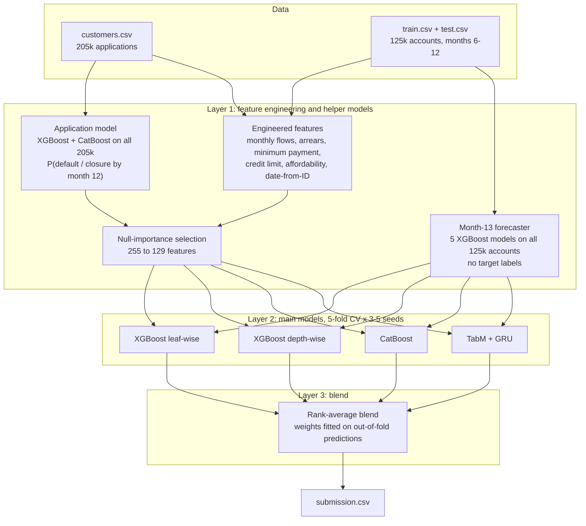

# Predicting Who Defaults in Year Two: AIFUL Behavioural Credit Scoring

**Task.** Every customer in the scoring population survived their first 12 months on an
AIFUL card loan without defaulting. Using what is known at month 12, rank them by their risk
of being in default by month 24. Metric: ROC AUC.

**Result.** Kaggle public AUC **0.76813** (leaderboard leader: 0.77152). Honest
cross-validated AUC 0.757, against 0.752 for the team's earlier baseline.

> The story in one line: **the data was the model.** The big gains came from understanding
> how AIFUL's loan works and how customers behave — fixing a timing artefact in "missed
> payments", learning from customers who never reach the scoring population, and teaching a
> model what "next month" looks like — not from swapping algorithms.

Column definitions and data quality details: [DATASET.md](DATASET.md).

---

## Chapter 1 — The population: who are we scoring?

AIFUL issued about 205,000 unsecured revolving loans in 2018. By month 12 they had split
three ways, and **only the survivors are scored**:

```
205,637 applications (customers.csv: application data only)
 ├── 19,900  defaulted within 12 months   (9.7%)   → no behaviour data
 ├── 60,420  closed or fully repaid early  (29.4%) → no behaviour data
 └── 125,317 still active at month 12      (60.9%) → train 93,987 + test 31,330
                                                     8.27% default by month 24
```

Three facts shape everything that follows:

1. **We only see 6 months of behaviour** (months 6–12) for the survivors: 7 month-end
   balances plus monthly borrowing and repayment amounts and counts.
2. **80,320 customers are in `customers.csv` but not in train or test.** They carry
   application data and an outcome at month 12 (default or closure). Most solutions ignore
   them; we didn't (Chapter 4).
3. **Default is mechanical:** 3 consecutive months without a payment. So how far behind a
   customer already is at month 12 matters enormously.

---

## Chapter 2 — What the data told us about the customers

Before any modelling we studied the data column by column. These are the patterns the rest
of the work builds on (default rate by month 24, train set):

### Who they are (application profile)

| Signal | Lower risk | Higher risk |
|---|---|---|
| Age | 60+: **5.7%** | under 25: **9.6%** |
| Job tenure at month 12 | 10+ years: **6.7%** | zero or negative: **11.6%** |
| Health insurance changed since application (a job-change signal in Japan) | no: 8.1% | **yes: 10.2%** |
| Housing | owner-occupied house: **7.1%** | public rental: **10.1%** |
| Application channel | contract office: **6.6%** | iPhone app: **9.3%** |
| Loans already held with other lenders | none: **6.9%** | four: **12.4%** |
| Total debt ÷ income | ≤ 10%: 7.5% | **> 50%: 10.3%** (above the legal 1/3 cap) |
| Occupation | civil servant: **7.1%** | hospitality / nightlife: **10.6%** |
| Marital status | married: 7.5% | single: 8.7% |

**Income is not monotonic:** under ¥2M defaults at 6.6%, ¥3–4M at 9.3%, over ¥7M at 7.4%.
Low earners get small limits; the middle band borrows the most relative to what it earns.

### How they behave (months 6–12)

- **52%** of customers ended month 12 with a higher balance than at month 6, and **67%**
  borrowed again in the last 3 months. This is a revolving product, and most customers revolve.
- **More than half sit at 90–100% of their estimated credit limit**, and they default at
  **9.2%**, against 5.8% for those at 75–90%.
- **"Stuck revolvers" are the riskiest balance pattern.** If the balance hasn't moved in
  3 months (±5%), they default at **11.0%**; if it fell more than 20%, at **3.4%**. A flat
  balance means payments cover only interest while the customer keeps re-borrowing.
- **The minimum payment is revealing, but not linearly:**

  | Months (of 6) paying exactly the minimum | Default rate |
  |---|---|
  | 0 (always pays more) | 7.5% |
  | 1–3 (sometimes only the minimum) | **9.9–10.8%** |
  | 6 (always exactly the minimum) | **5.4%** |

  Paying *only sometimes* the minimum signals strain; paying it like clockwork is a
  disciplined (often automatic) habit.

### Two hidden pieces of structure

- **The ID is a date.** `ID // 10000 − 21185` is the day of 2018 the loan was issued
  (`ID % 10000` is the order within that day). It shows a weekly cycle and a New Year dip,
  and loans from **September to November default less (7.3–7.8%)** than earlier vintages
  (8.3–9.0%). Their month-24 outcome falls in early 2020, a plausible macro or
  forbearance effect.
- **AIFUL's minimum-payment schedule can be recovered from the data:** about ¥4k under
  ¥100k of balance, ¥8k under ¥200k, ¥11k under ¥400k, ¥13k under ¥500k, and so on.

### The insight that changed the features: missed payments are partly an artefact

Behaviour is recorded in windows running from the loan's start day to the same day next month,
while the payment due date can fall anywhere inside them. A customer who pays on time can have a
payment slide across the boundary, leaving one window empty and the next with two payments.

- The average number of "empty" windows ranges from **0.43 to 0.78 depending only on the day
  of the month the loan started.**
- Empty windows that are caught up straight away default at **6%**, the same as perfect
  payers; genuine misses default at **10%**.

So "months with no payment", the obvious delinquency feature, was **noisy**. Fixing it
became the core of the feature engineering (Chapter 3).

### Where the risk hides

| Segment | Share of all defaulters | Default rate | Model AUC within segment |
|---|---|---|---|
| Clean payers (never missed a window) | **41%** | 5.3% | **0.667** |
| Missed before, paying now | 27% | 8.8% | 0.700 |
| Currently missing payments | 32% | 20–60% | 0.80–0.94 |

The delinquent are easy to rank. **The hard problem is the clean payers:** 41% of all
defaulters with no warning sign in their payment history.

---

## Chapter 3 — Feature engineering, driven by those findings

Each feature family answers one of the findings above. Gains are measured with honest
cross-validation (Chapter 6).

### 3.1 From cumulative columns to monthly behaviour (+0.011 AUC)
The flow columns are cumulative ("past 3 months" includes past 1 and 2), so we
**differenced them into single months**. On top of that: balance slope, volatility, 1/3/6-month
changes, net cash flow, repayment and borrowing trends, months borrowing without paying.
→ Raw columns alone scored 0.738; with these, **0.749**.

### 3.2 Arrears: delinquency without the artefact (best single features)
Instead of counting empty windows, we **walk through the months keeping a running tally of what
is owed**, as a lender's collections system would:
- each month with a balance owes 1 payment and the minimum amount;
- payments reduce what is owed;
- extra payments clear past arrears but do not build credit for the future.

```
window:     Oct  Nov  Dec          Oct  Nov  Dec
paid:        1    0    2            1    0    1
arrears:     0    1    0   ← caught up         0    1    1   ← genuinely behind
```

This produced 41 features: arrears by count and by amount (in months of minimum due),
streaks, cumulative gaps, real versus caught-up misses, and a flag for start days near a
window boundary.

| Arrears at month 12 | 0 | 1 | 2 | 3 | 4+ |
|---|---|---|---|---|---|
| Default by month 24 | 5.4% | 11.9% | 29.7% | 43.8% | 61.2% |

**Single-feature AUC 0.661–0.667, against 0.620 for the naive missed-month count.**
The arrears family now carries 14% of the model's importance; the old counts carry 2%.

### 3.3 Minimum payment, credit limit and affordability
- **Minimum payment:** the inferred schedule gives a minimum due per month, hence
  payment ÷ minimum ratios, short / exact / over-payment months, and shortfall.
- **Credit limit:** AIFUL's limit is its own risk decision but isn't given. We estimate it as the
  larger of the desired limit and the peak balance rounded up, then derive utilisation,
  headroom, and borrowing while near the ceiling.
- **Affordability:** debt-to-income, room under the legal 1/3-of-income lending cap (総量規制),
  rent ÷ income, verified ÷ declared income, interest's share of each payment (the stuck-revolver
  signal), and changes since application in insurance type, company size and marital status.

### 3.4 Learning from customers we never score (+0.0005)
The 19,900 early defaulters and 60,420 early closers have no behaviour data, but they do have
application data. We trained an **application model on all 205,637 customers** to predict the
month-12 outcome (active / defaulted / closed), out-of-fold so no customer scores itself, and
fed its probabilities into the main model.

- Its score separates month-24 risk **2.8×**: from 4.6% in the safest fifth of customers to
  12.7% in the riskiest.
- It's **the strongest single signal for clean payers** (AUC 0.60), the segment where payment
  history says nothing.

### 3.5 The date hidden in the ID (+0.0006)
Application day, weekday, day of month, month (vintage), order within the day, and the gap
between payday and the loan's start day.

### 3.6 Pruning: less is more (+0.0013)
255 engineered features contained many near-duplicates. A **null-importance test** (each feature
must beat its own importance when the labels are randomly shuffled) kept **129**. Every repeat
of the cross-validation improved.

### 3.7 A self-supervised "next month" forecaster (+0.0004 to +0.0009 per model)
The target is about months 13–24, which we cannot see. But month-to-month behaviour **can** be
learned from the months we do see, on all 125k accounts (train and test), **without using the
target at all**:

```
months:        7    8    9    10   11   12  | 13
example A:    [ 4 months of history ] → 11
example B:         [ 4 months of history ] → 12
apply:                  [ 4 months of history ] → 13 (forecast)
```

Five small models forecast month 13's missed payment, new borrowing, arrears, payment ÷ minimum
and balance change, and "surprise" features measure how far month 12 deviated from what the
customer's own pattern predicted.

- The forecasts are calibrated: a predicted 9.3% month-13 miss rate, against 8.9–9.3% observed
  in months 11–12.
- **`fc_arrears` (forecast month-13 arrears) became the #1 feature overall.**
- It helped the neural network most (+0.0027), because the network can't build these
  month-to-month interactions itself.

### 3.8 What we tried that did not help, and what it taught us

| Idea | Result | Lesson |
|---|---|---|
| Target encoding of categories and their combinations | −0.0009 | Trees already extract the category signal |
| Income, balance and debt relative to peer groups | −0.0018 to −0.0023 | Redundant with the ratios we have |
| Category frequency encoding | −0.0004 | No new information |
| Recent behaviour vs. the customer's own history | −0.0003 | The forecaster's surprise features already capture it |
| Clusters of balance and payment trajectories | −0.0011 | Too coarse for what the trees see directly |
| Extra affordability ratios | −0.0002 | Redundant |
| Training only on the top 20 / 60 / 100 features | −0.0088 / −0.0017 / ±0 | The signal is spread across many features; 129 + 12 is the sweet spot |
| Default rate of each application day (vintage) | ±0 | The date features already carry the vintage effect |
| Interest rate implied by balance changes, as a risk grade | no signal | Clusters at the legal 18% |

Most of these families aimed at the clean payers. All of them failed under a fair test (one that
keeps the number of features each tree sees constant). **The clean payers' risk is not in this
data**: it comes from events the lender can't see here, such as job loss or borrowing elsewhere
(see Chapter 8).

---

## Chapter 4 — Choosing the models

### Why gradient-boosted trees carry the solution
- **Tabular data with mixed types and many thresholds** ("arrears ≥ 2", "utilisation > 90%"):
  trees find these splits natively.
- **Robust to outliers and missing values:** they split on rank order, so an income of ¥9.5e10
  needs no special handling.
- **Interactions come for free:** "young × high utilisation × recent borrowing" emerges from
  tree depth.
- **The right size for ~94k rows:** large enough for boosting, small enough that deep learning
  has no data advantage. Published tabular benchmarks agree.

### Why a neural network too
A model that makes **different mistakes** is worth more in a blend than a slightly stronger
model of the same kind. Our tree models correlate at 0.97–0.99 with each other; the neural
network at about 0.92–0.96.

### The four main models

| Model | What it is | Role in the team | OOF AUC |
|---|---|---|---|
| **XGBoost, leaf-wise** (`xgbl`) | Trees grown by splitting whichever leaf helps most (LightGBM style) | **The workhorse**: best at narrow high-risk pockets | 0.757 |
| **XGBoost, depth-wise** (`xgb`) | Balanced trees grown level by level | Broad, stable interactions | 0.757 |
| **CatBoost** | Symmetric trees with native categorical handling | Learns occupation, industry, etc. as categories rather than numbers | 0.753 |
| **TabM** | 32 small networks sharing one backbone and averaged; piecewise-linear feature encoding; a GRU reads the monthly history | **Diversity**: the most different model in the blend | 0.752 |

---

## Chapter 5 — Architecture and pipeline



### Pipeline steps
1. **Join and clean:** merge train and test with `customers.csv` on `ID`; turn cumulative flows
   into monthly values; flag impossible values.
2. **Helper models:** the application model (205k customers) and the month-13 forecaster
   (125k accounts), both out-of-fold.
3. **Feature build and selection:** 255 engineered + 12 forecast features, pruned to
   129 + 12.
4. **Main models:** each trained with honest cross-validation (below); test predictions
   averaged over 15–25 fold models each.
5. **Blend:** predictions converted to ranks and combined with weights that maximise
   out-of-fold AUC.

---

## Chapter 6 — Making sure the numbers are honest

The public leaderboard uses about 15,600 rows, so it moves by about **±0.007** by chance, and
two similar submissions differ by about **±0.0005**. Decisions were therefore made on our own
validation, designed so its numbers can be trusted:

- **5-fold stratified cross-validation, repeated with 3–5 different seeds.** A change is kept
  only if it improves every repeat.
- **The validation fold is never used for early stopping.** The number of trees is chosen on an
  inner 10% holdout of the training part, then the model is refit (the earlier baseline stopped
  on the validation fold, which inflates scores).
- **Out-of-fold everything:** the application model, the forecaster and target encodings never
  score a customer they were trained on.
- **Nested blend scoring:** blend weights are fitted on 4/5 of the rows and scored on the
  remaining 1/5.
- **Paired comparisons:** variants share folds and seeds, so differences reflect the change,
  not the luck of the split.

---

## Chapter 7 — Results

### How we got there

| Stage | What changed | OOF AUC | Kaggle public |
|---|---|---|---|
| Team baseline | Engineered features, 3 boosted models | 0.7522 | — |
| v1 | Honest CV, date from ID, application model, GPU models, first neural network | 0.7549 | 0.76686 |
| v2 | Arrears, credit limit, better application model, pruning, TabM | 0.7564 | 0.76731 |
| **v3** | **Month-13 forecaster**, 5 seeds on the best model | **0.7572** | **0.76813** |
| v4 | TabM with forecast features | 0.7574 | 0.76745 |
| v5 | Re-tuned on a larger GPU (A5000) | 0.7575 | 0.76580 |

v3 to v5 differ by less than the leaderboard's noise between similar submissions; v3 is kept as
the best public score.

### What drives the predictions (top features by SHAP importance)

1. **Forecast month-13 arrears:** the forecaster's view of how far behind the customer will be
2. **Balance change in the last 1–2 months:** drawing credit right before the outcome window
3. **Job tenure:** short or zero tenure is a strong risk signal
4. **Verified ÷ declared income:** gaps between the two flag risk
5. **Application-profile risk:** learned from the 19,900 early defaulters
6. **Application month (vintage)**, **age**, **borrowing trend**, **interest share of payments**,
   and **arrears over the last 2–3 months**

Share of importance by feature family: monthly balance and flow dynamics 20%, raw columns 18%,
**arrears 14%**, **forecast 11%**, affordability ratios 10%, application model 8%,
utilisation 7%, minimum payment 4%, date 3%, credit limit 3%.

### The consumer story the model learned
A customer at risk of defaulting in year two typically:
- has **started falling behind**, or is forecast to: arrears dominate;
- **kept borrowing right up to month 12**, near the limit, with a balance that is not coming
  down;
- has a **thin buffer**: short job tenure, a recent job change, other loans, high debt-to-income;
- **looks like early defaulters at application**: younger, renting, applied by smartphone.

The 41% who default with a clean record look like ordinary customers in this data, which is
the natural limit of any model built on it.

---

## Chapter 8 — Approaches best suited to this problem in theory

These were **not implemented**, either because the data does not support them or because of
time. They are what a production credit-risk team would consider next.

| Approach | Why it fits | What it needs |
|---|---|---|
| **Credit-bureau data** (JICC / CIC in Japan) | The clean payers' risk lives elsewhere: new loans and missed payments at other lenders. The single biggest likely gain. | Bureau access |
| **Discrete-time survival (hazard) model** | Models *when* default happens month by month, using all partial information | Default month, not just a flag |
| **Roll-rate / Markov chain model** | The industry-standard view of delinquency: current → 1 behind → 2 behind → default. Our forecaster is a one-step learned version; chaining it 12 steps would simulate month 24. | Longer history to validate multi-step transitions |
| **Competing risks** (default vs. early repayment) | Customers who repay early can never default; modelling both outcomes jointly corrects the risk estimate | Closure timing |
| **Survivorship-bias correction** (inverse probability weighting) | The scored population is selected: only survivors of year one. Weighting by the probability of surviving lets the model generalise to new cohorts. | Already possible with the application model |
| **Multi-task neural network** | One network trained on both 205k application outcomes and the 94k behavioural targets, sharing what it learns | Implementation time |
| **Longer behaviour sequences + Transformers** | Attention earns its keep with 24–36 months of history, not 6 | More history |
| **Macroeconomic / vintage adjustment** | Late-2018 loans reached month 24 in early 2020 | Macro series, more vintages |
| **Monotonic scorecard** (WoE logistic regression or monotone-constrained boosting) | Regulators and credit officers need explainable, monotonic risk drivers | — |

---

## Appendix — Files

| File | Purpose |
|---|---|
| [DATASET.md](DATASET.md) | Dataset guide: every column, codes, data quality, feature list |
| `features.py` | Preprocessing, all engineered features, application model |
| `forecast.py` | Self-supervised month-13 forecaster |
| `select_features.py` | Null-importance feature selection |
| `train_gbm.py` / `train_tabm.py` | Main models with honest cross-validation |
| `blend.py` | Rank blend, nested scoring, writes submissions |
| `fe_lab.py` / `topk.py` / `ablation.py` | Feature experiments behind Chapter 3.8 |
| `tune.py` / `run_variants.sh` | Tuning and the multi-variant GPU pipeline |
| `feature_importance.csv` | SHAP ranking of the 141 features in the best model |
| `submission_best_public.csv` | Best Kaggle public submission (0.76813) |
