# Predicting Who Defaults in Year Two: AIFUL Behavioural Credit Scoring

**Task.** Every customer in the scoring population survived their first 12 months on an
AIFUL card loan without defaulting. Using what is known at month 12, rank them by their risk
of being in default by month 24. Metric: ROC AUC.

**Result:** Kaggle public AUC **0.76813**.

> The story in one line: **the data was the model.** The gains came from understanding how
> AIFUL's loan works and how its customers behave — fixing a timing artefact in "missed
> payments", learning from customers who never reach the scoring population, and teaching a
> model what the next months look like — not from swapping algorithms.


Column definitions and data quality details: [DATASET.md](DATASET.md). All figures are
generated by `make_plots.py`.

---

## Chapter 1 — The population: who are we scoring?

AIFUL issued about 205,000 unsecured revolving loans in 2018. By month 12 they had split
three ways, and **only the survivors are scored**:

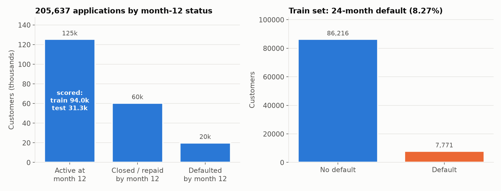

```
205,637 applications (customers.csv: application data only)
 ├── 19,900  defaulted within 12 months   (9.7%)   → no behaviour data
 ├── 60,420  closed or fully repaid early  (29.4%) → no behaviour data
 └── 125,317 still active at month 12      (60.9%) → train 93,987 + test 31,330
                                                     8.27% default by month 24
```

Four facts shape everything that follows:

1. **We only see 6 months of behaviour** (months 6–12) for the survivors: 7 month-end
   balances plus monthly borrowing and repayment amounts and counts.
2. **80,320 customers are in `customers.csv` but not in train or test.** They carry
   application data and an outcome at month 12 (default or closure), and we learn from them
   (Chapter 3).
3. **Default is mechanical:** 3 consecutive months without a payment. So how far behind a
   customer already is, and is likely to fall, matters enormously.
4. **The target is imbalanced:** only 8.27% of the training customers default (7,771 of
   93,987).

---

## Chapter 2 — What the data told us about the customers

Before any modelling we studied the data column by column (default rate by month 24, train set).

### Who they are (application profile)

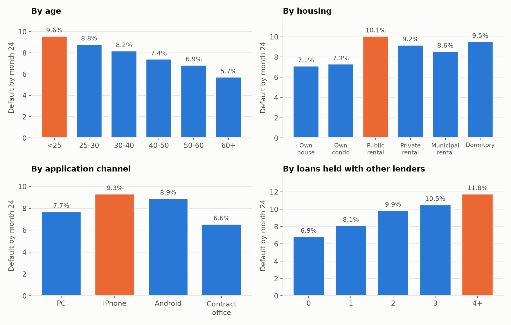

| Signal | Lower risk | Higher risk |
|---|---|---|
| Age | 60+: **5.7%** | under 25: **9.6%** |
| Job tenure at month 12 | 10+ years: **6.7%** | zero or negative: **11.6%** |
| Health insurance changed since application (a job-change signal in Japan) | no: 8.1% | **yes: 10.2%** |
| Housing | owner-occupied house: **7.1%** | public rental: **10.1%** |
| Application channel | contract office: **6.6%** | iPhone app: **9.3%** |
| Loans already held with other lenders | none: **6.9%** | four or more: **11.8%** |
| Total debt ÷ income | ≤ 10%: 7.5% | **> 50%: 10.3%** (above the legal 1/3 cap) |
| Occupation | civil servant: **7.1%** | hospitality / nightlife: **10.6%** |
| Marital status | married: 7.5% | single: 8.7% |

**Income is not monotonic:** under ¥2M defaults at 6.6%, ¥3–4M at 9.3%, over ¥7M at 7.4%.
Low earners get small limits; the middle band borrows the most relative to what it earns.

### How they behave (months 6–12)

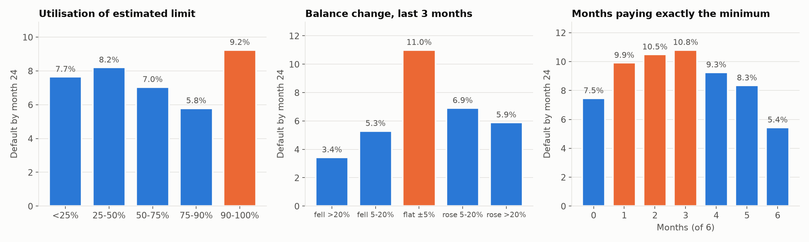

- **This is a revolving product, and most customers revolve:** 52% ended month 12 with a
  higher balance than at month 6, and 67% borrowed again in the last 3 months.
- **More than half sit at 90–100% of their estimated credit limit**, and they default at
  **9.2%**, against 5.8% for those at 75–90%.
- **"Stuck revolvers" are the riskiest balance pattern.** A balance flat over 3 months (±5%)
  defaults at **11.0%**; one that fell more than 20% at **3.4%**. Payments cover only interest
  while the customer keeps re-borrowing.
- **The minimum payment is revealing, but not linearly.** Paying *only sometimes* the minimum
  (1–3 months of 6) signals strain (**9.9–10.8%**). Paying it every month like clockwork is a
  disciplined, often automatic habit (**5.4%**).

### Two hidden pieces of structure

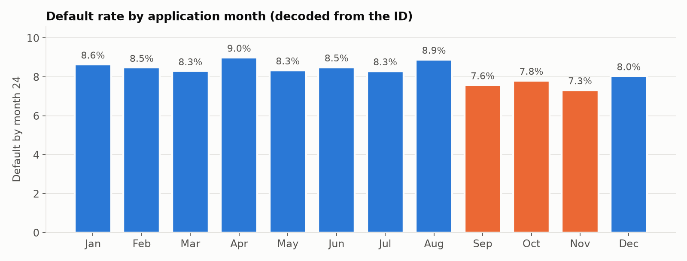

- **The ID is a date.** `ID // 10000 − 21185` is the day of 2018 the loan was issued
  (`ID % 10000` is the order within that day). Loans from **September to November default
  less (7.3–7.8%)** than earlier vintages (8.3–9.0%). Their month-24 outcome falls in early
  2020, a plausible macro or forbearance effect.
- **AIFUL's minimum-payment schedule can be recovered from the data:** about ¥4k under
  ¥100k of balance, ¥8k under ¥200k, ¥11k under ¥400k, ¥13k under ¥500k, and so on.

### The insight that changed the features: missed payments are partly an artefact

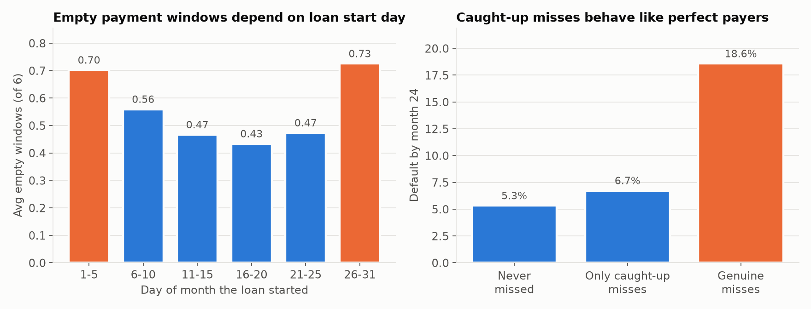

Behaviour is recorded in windows running from the loan's start day to the same day next month,
while the payment due date can fall anywhere inside them. A customer who pays on time can have a
payment slide across the boundary, leaving one window empty and the next with two payments.

- **The artefact:** the average number of "empty" windows ranges from 0.43 to 0.73
  **depending only on the day of the month the loan started.**
- **Caught-up misses are harmless:** customers whose empty windows were all caught up straight
  away default at **6.7%**, close to perfect payers (5.3%).
- **Genuine misses are not:** those customers default at **18.6%**.

So "months with no payment", the obvious delinquency feature, was **noisy**. Fixing it became
the core of the feature engineering.

### Where the risk hides

| Segment | Share of all defaulters | Default rate |
|---|---|---|
| Clean payers (never missed a window) | **41%** | 5.3% |
| Missed before, paying now | 27% | 8.8% |
| Currently missing payments | 32% | 20–60% |

The delinquent are easy to rank. **The hard problem is the clean payers:** 41% of all
defaulters with no warning sign in their payment history.

---

## Chapter 3 — Layer 1: turning data into features

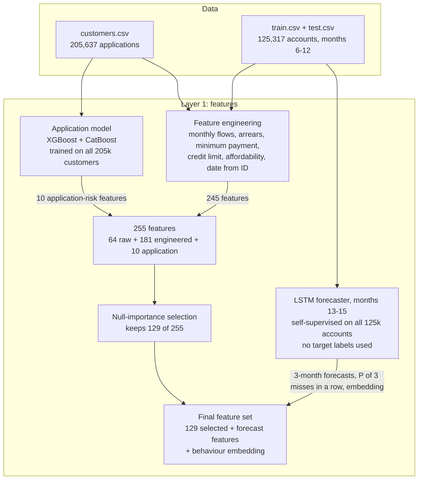

Layer 1 has four parts:
1. An **application model** turns 205k application records into 10 risk scores.
2. **Feature engineering** turns the raw behaviour into 245 features grounded in Chapter 2's
   insights.
3. **Null-importance selection** keeps the 129 features that carry real signal.
4. A **self-supervised forecaster** predicts each customer's next 3 months of behaviour.

### 3.1 Application-risk features: learning from customers we never score

The 19,900 early defaulters and 60,420 early closers have no behaviour data, but they do have
application data. We trained an **application model on all 205,637 customers** to predict the
month-12 outcome (active / defaulted / closed) from **application data alone**.

- **Models:** XGBoost and CatBoost. CatBoost reads occupation, industry and so on as real
  categories; averaging the two steadies the score.
- **Out-of-fold:** no customer is scored by a model that saw them.

It produces **10 features**: three scores, each from XGBoost, CatBoost and their average, plus
one survival score.

| Feature | What it tells | Kept by selection? |
|---|---|---|
| `app_p_def12` (+ `_xgb`, `_cat`) | How likely this **application profile** is to default within 12 months | ✅ |
| `app_def_vs_active` (+ `_xgb`, `_cat`) | Early-default odds against staying active, compared with survivors only | ✅ |
| `app_p_closed12` (+ `_xgb`, `_cat`) | How likely the profile is to repay early | ❌ |
| `app_p_active12` | How likely the profile is to still be a customer at month 12 | ❌ |

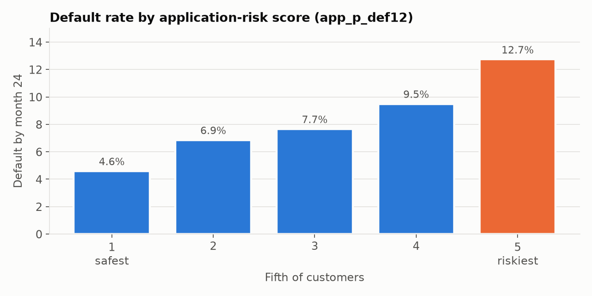

**What they tell us:**
- **Origination frailty persists.** People who looked risky at application stay riskier
  after a year of paying: month-24 default rises **2.8×**, from 4.6% in the safest fifth to
  12.7% in the riskiest.
- **They help where payment history can't.** For clean payers this is the strongest single
  signal: the profile (young, renting, smartphone applicant, other loans, high debt-to-income)
  is the only warning there is.
- **Early-repayment propensity carries no extra signal.** The closure and active scores were
  dropped by selection.

### 3.2 Feature engineering: from insights to features

Every feature family answers a Chapter 2 insight.

| Insight (Chapter 2) | Feature family | What it measures |
|---|---|---|
| Flows are cumulative ("past 3 months" includes 1 and 2) | **Monthly flows & balance** (62) | Single-month borrowing and repayment; balance slope, volatility, 1/3/6-month changes; net cash flow; borrowing and repayment trends; months borrowing without paying |
| Missed windows are partly an artefact | **Arrears** (41) | A running tally of what is owed (below) |
| AIFUL's minimum schedule is recoverable | **Minimum payment** (12) | Minimum due per month; payment ÷ minimum; short, exact and over-payment months; shortfall |
| The credit limit is AIFUL's risk decision but isn't given | **Credit limit & utilisation** (26) | Estimated limit (desired limit or peak balance, rounded up); utilisation; headroom; borrowing near the ceiling; interest's share of payments (the stuck-revolver signal) |
| Debt burden and job changes matter | **Affordability ratios** (18) | Debt-to-income, room under the legal 1/3-of-income cap (総量規制), rent ÷ income, verified ÷ declared income, changes in insurance type, company size and marital status since application |
| The ID is a date | **Date from ID** (8) | Application day, weekday, day of month, month (vintage), order within the day, payday gap |
| — | **Missed-window counts** (14) | The naive delinquency counts, kept for comparison |

**Arrears, the core feature.** Instead of counting empty windows, we **walk through the months
keeping a running tally of what is owed**, as a lender's collections system would:
- each month with a balance owes 1 payment and the minimum amount;
- payments reduce what is owed;
- extra payments clear past arrears but do not build credit for the future.

```
window:     Oct  Nov  Dec          Oct  Nov  Dec
paid:        1    0    2            1    0    1
arrears:     0    1    0   ← caught up         0    1    1   ← genuinely behind
```

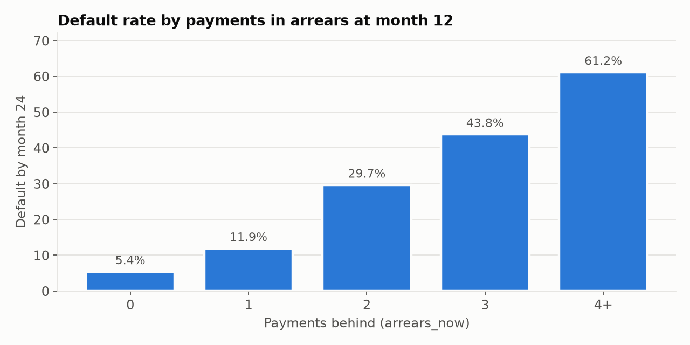

Arrears turn a noisy count into a clean staircase of risk: **5.4% → 11.9% → 29.7% → 43.8% →
61.2%**. Each payment behind roughly doubles the risk, and 3 behind is the default rule itself.

### 3.3 Null-importance selection: how 129 of 255 features were shortlisted

The pool of 255 features (64 raw + 181 engineered + 10 application) held many near-duplicates.
For example, the raw cumulative columns and their monthly versions say the same thing. Noise
features hurt, because each tree samples only a fraction of the features.

**The test:**
1. **Train on the real labels** (3 runs) and record each feature's *gain*: how much it helps.
2. **Shuffle the labels randomly and train 30 more times.** Nothing real can be learned, so any
   gain a feature gets here is the model fitting noise.
3. **Keep the feature only if its real gain beats the 75th percentile of its gain on shuffled
   labels.**

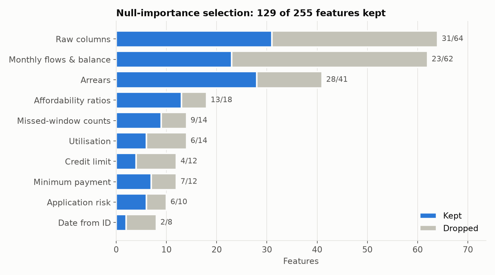

**What was shortlisted:**
- **Arrears survived best:** 28 of 41 kept, including the **8 strongest features of the whole
  pool**. `arrears_now` scored about **700×** above its noise level.
- **Raw columns were halved** (31 of 64): the engineered versions replace them.
- **Application risk:** all 6 default-risk scores kept, all 4 closure/active scores dropped.
- **Date from ID:** only 2 of 8 kept. The vintage matters; the weekday and day of month don't.

The 129-feature model beat the full 255-feature model on every cross-validation repeat.

### 3.4 Forecasting the next 3 months

**Why forecast?**
- **The path to default is visible in advance.** Default means 3 missed months in a row, so
  months 13–15 are exactly that path, and we can't observe them.
- **Behaviour itself can be learned without the target.** Month-to-month habits can be learned
  from the months we *do* see, on all 125k accounts (train and test).
- **That gives far more training signal.** The main models learn from only 7,771 defaults; a
  forecaster learns from hundreds of thousands of month-to-month transitions.

**One-month forecaster.** Five XGBoost models read 4 months of history and
predict the next month. Trained on months 7–10 → 11 and 8–11 → 12, then applied to months 9–12
to forecast **month 13**.

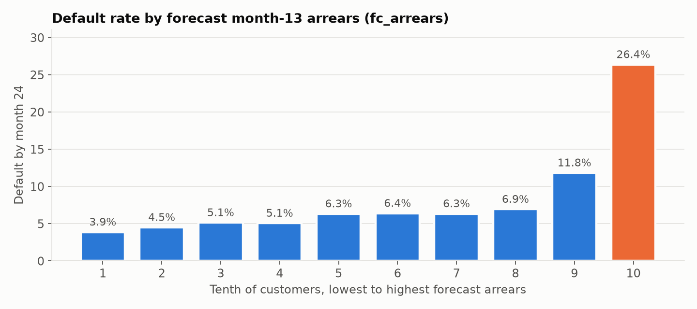

Its forecast arrears separate risk sharply. The top tenth of customers by forecast arrears
default at **26.4%**, against 3.9% for the bottom tenth, and `fc_arrears` became the **#1
feature overall** (Section 3.5).

**Three-month LSTM forecaster for months 13–15.**

```
months:        7    8    9  | 10   11   12      ← train: 3 months in, next 3 out
apply:                       10   11   12  | 13   14   15   (forecast)
```

- **Model:** an LSTM reads the monthly history in order (balances, borrowing, repayments,
  arrears, payment ÷ minimum) plus a few static attributes. A multi-output head forecasts
  **each of the next 3 months**: missed payment, arrears, payment ÷ minimum, balance change and
  new borrowing.
- **Training:** self-supervised on all 125k accounts (months 7–9 → 10–12), then applied to
  months 10–12.

**How the forecasts help the Layer 2 models:**

| Forecast feature | How it helps |
|---|---|
| **Forecast arrears and miss probability, months 13–15** | Tells the models *where the customer is heading*, not just where they are. Two customers both 1 payment behind today can have very different trajectories. |
| **P(3 misses in a row in months 13–15)** | The default rule itself, estimated directly: the most target-aligned feature a label-free model can produce |
| **Surprise:** month-12 actual minus forecast | Flags customers who just broke their own pattern, for example paying far less than usual. A change in behaviour is an early warning even before arrears appear. |
| **Behaviour embedding** (the LSTM's hidden state) | A compact learned summary of the customer's monthly behaviour that Layer 2 models can use directly |

The forecasts compress dozens of monthly inputs into a few numbers the main models would
otherwise have to learn from 7,771 defaults alone. They help the neural model most, because it can't easily construct these month-to-month interactions itself.

### 3.5 Which features matter most

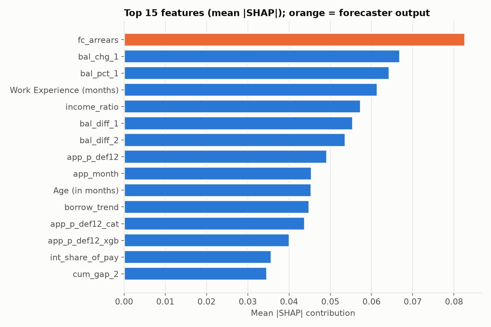

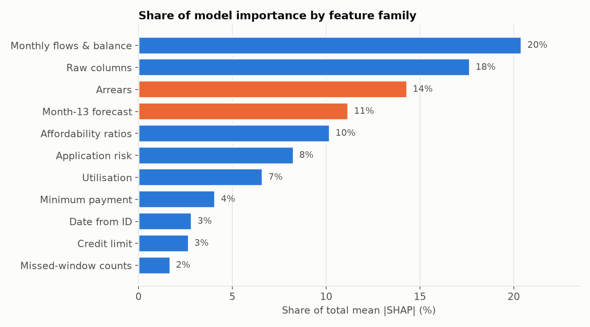

- **The forecast arrears lead.** Recent balance changes (`bal_chg_1`, `bal_diff_1/2`), job
  tenure, verified ÷ declared income and the application-risk score follow.
- **The two families we designed around the data's quirks carry a quarter of the model:**
  arrears (14%) and the forecast (11%). The naive missed-window counts they replaced carry 2%.

### 3.6 What Layer 1 taught us about consumer behaviour

**1. Falling behind is a staircase, and the next step is predictable.** Once the timing
artefact is removed, each payment missed roughly doubles the risk. Where a customer is heading
(forecast arrears) matters even more than where they are.

**2. Borrowing right up to the edge is the strongest behavioural warning.**
- Customers who drew credit in the last 1–2 months before month 12 are riskier.
- So are customers at 90–100% of their limit.
- So are customers whose balance stays flat while they keep borrowing ("stuck revolvers").

**3. How someone pays says as much as whether they pay.** Paying exactly the minimum *only
sometimes* signals cash-flow strain. Paying it every month, often by auto-debit, signals
discipline. Interest eating most of each payment means the debt isn't shrinking.

**4. A thin buffer shows up before the missed payments:** short or zero job tenure, a recent
job change (insurance type changed), other loans, debt above the legal 1/3 cap, and a gap
between declared and verified income.

**5. Risk at application persists.** Profiles that resemble early defaulters (younger,
renting, applying by smartphone, already borrowing elsewhere) stay riskier a year later, even
after paying on time.

**6. The clean payers' risk is mostly invisible here.** 41% of defaulters never missed a
payment. Every feature family we added for them was redundant once tested fairly: their default
is driven by events this data doesn't contain, such as job loss or borrowing elsewhere
(Chapter 6).

### 3.7 What we tried that did not help

| Idea | Lesson |
|---|---|
| Target encoding of categories and their combinations | Trees already extract the category signal |
| Income, balance and debt relative to peer groups | Redundant with the ratios we have |
| Category frequency encoding | No new information |
| Recent behaviour vs. the customer's own history | The forecaster's surprise features already capture it |
| Clusters of balance and payment trajectories | Too coarse for what the trees see directly |
| Training only on the top 20–100 features | The signal is spread across many features |
| Interest rate implied by balance changes, as a risk grade | Clusters at the legal 18%; no signal |

---

## Chapter 4 — Layer 2 and Layer 3: models and blend

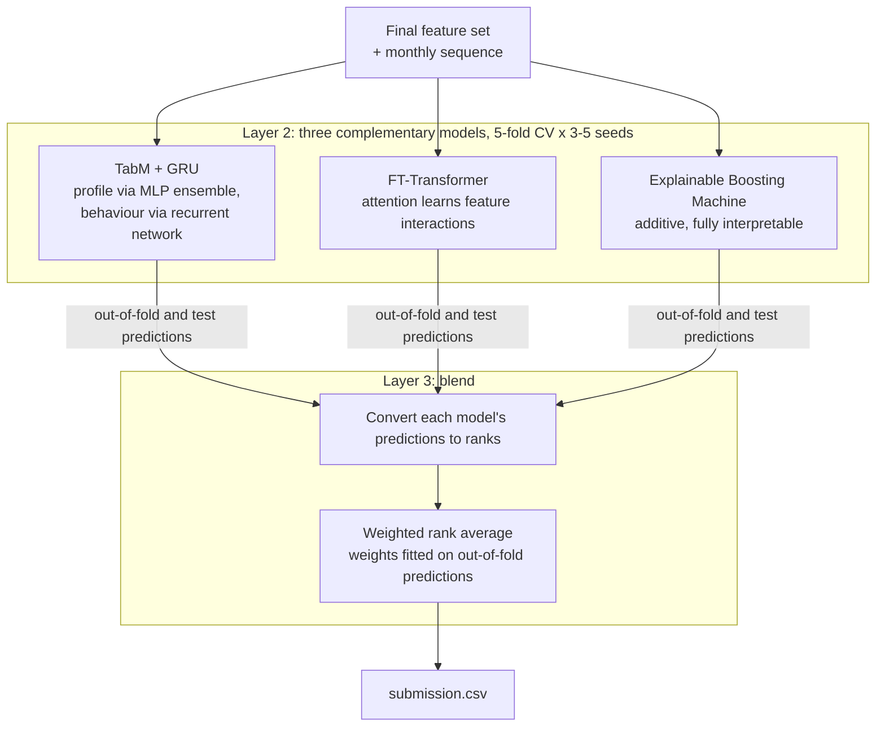

### Why these three models

The pipeline combines gradient-boosted trees (XGBoost and CatBoost) with TabM + GRU. Two lessons shaped the model design:
- **The tree models were near-copies of each other** (rank correlation 0.97–0.99), so adding
  more of them added little.
- **The neural model made different mistakes** (correlation 0.92–0.96) and earned about 30% of
  the blend weight despite being weaker alone.

So Layer 2 uses three models that each **see the data in a genuinely different way**:

| Model | How it sees the data | Why it suits this task |
|---|---|---|
| **TabM + GRU** | Profile via an ensemble-style MLP; behaviour via a recurrent network reading the months in order | Captures sequence patterns ("paid less each month, then borrowed") that a flat table only approximates |
| **FT-Transformer** | Every feature becomes a token; **attention** learns which features interact for each customer | Learns interactions such as forecast arrears × income buffer explicitly, a different inductive bias from MLPs |
| **Explainable Boosting Machine (EBM)** | A sum of learned per-feature curves plus selected pairwise interactions (GA²M) | Accuracy close to boosted trees, but **fully interpretable**: every feature's effect on risk can be plotted, the standard credit regulators and risk teams expect |

### What TabM and the GRU do

- **TabM branch (the selected features).**
  - **Encoding:** each feature is split into 16 quantile bins and encoded piecewise-linearly, so
    the network sees *where* a value sits in its distribution (robust to outliers such as an
    income of ¥9.5e10).
  - **Network:** one shared MLP backbone with **32 lightweight members**. Each member scales the
    input with its own learned vector and has its own output head.
  - **Prediction:** their average, an ensemble of 32 networks at almost the cost of one
    (*TabM*, Gorishniy et al., 2024).
- **GRU branch (the monthly history).** A bidirectional GRU, a recurrent network closely related
  to the LSTM, reads the 6 months **in order**. For each month it sees opening and closing
  balance, borrowing, repayments, arrears and payment ÷ minimum, and captures sequence patterns
  a feature table only approximates.
- **Fusion:** both branches are concatenated before the output, combining the customer's static
  profile with their behaviour over time.

### Validation and blend
- **Honest validation:** 5-fold stratified cross-validation, repeated with 3–5 seeds. Training
  length is chosen on an inner holdout, **never on the validation fold**, and every helper model
  is out-of-fold. A change is kept only if it improves every repeat.
- **Rank blend:** each model's predictions become ranks, since AUC depends only on ordering,
  then are averaged with weights that maximise out-of-fold AUC. The blend's own score is
  nested: weights fitted on 4/5 of the rows, scored on the other 1/5.
- **Why not chase the leaderboard:** the public leaderboard uses about 15,600 rows, so two
  similar submissions differ by about ±0.0005 by chance. Decisions were made on our
  validation instead.

---

## Chapter 5 — The complete pipeline

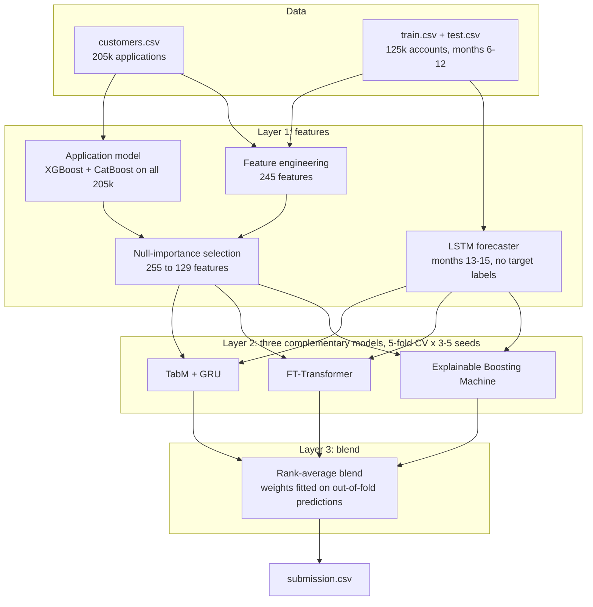

**End to end:**
1. **Join and clean:** merge train and test with `customers.csv` on `ID`, turn cumulative
   flows into monthly values, and flag impossible values.
2. **Layer 1:** train the application model (out-of-fold) and the forecaster (label-free),
   build 255 features, select 129, and add the forecast features and behaviour embedding.
3. **Layer 2:** train TabM + GRU, FT-Transformer and EBM with honest cross-validation.
4. **Layer 3:** blend their ranks and write `submission.csv` with all 31,330 test IDs.

**Result:** Kaggle public AUC **0.76813**.

---

## Chapter 6 — Approaches best suited to this problem in theory

| Approach | Why it fits | What it needs |
|---|---|---|
| **Credit-bureau data** (JICC / CIC in Japan) | The clean payers' risk lives elsewhere: new loans and missed payments at other lenders. The single biggest likely gain. | Bureau access |
| **Discrete-time survival (hazard) model** | Models *when* default happens month by month, using all partial information | Default month, not just a flag |
| **Roll-rate / Markov chain model** | The industry-standard view of delinquency: current → 1 behind → 2 behind → default. The forecaster is a learned version; chaining it further would simulate month 24. | Longer history to validate multi-step transitions |
| **Competing risks** (default vs. early repayment) | Customers who repay early can never default; modelling both outcomes jointly corrects the risk estimate | Closure timing |
| **Survivorship-bias correction** (inverse probability weighting) | The scored population only contains survivors of year one. Weighting by the probability of surviving helps the model generalise to new cohorts. | Already possible with the application model |
| **Multi-task neural network** | One network trained on both the 205k application outcomes and the 94k behavioural targets | Implementation time |
| **Macroeconomic / vintage adjustment** | Late-2018 loans reached month 24 in early 2020 | Macro series, more vintages |
| **Monotonic scorecard** (WoE logistic regression or monotone-constrained boosting) | Regulators and credit officers need explainable, monotonic risk drivers | — |

---

## Appendix — Files

| File | Purpose |
|---|---|
| [DATASET.md](DATASET.md) | Dataset guide: every column, codes, data quality, feature list |
| `features.py` | Preprocessing, all engineered features, application model |
| `forecast.py` | Self-supervised forecaster for months 13–15 |
| `select_features.py` | Null-importance feature selection |
| `train_gbm.py` / `train_tabm.py` | Models with honest cross-validation |
| `blend.py` | Rank blend, nested scoring, writes submissions |
| `fe_lab.py` / `topk.py` / `ablation.py` | Feature experiments behind Section 3.7 |
| `tune.py` / `run_variants.sh` | Tuning and the multi-variant GPU pipeline |
| `make_plots.py` → `plots/` | All figures in this document |
| `feature_importance.csv` | SHAP ranking of the features in the best model |
| `submission_best_public.csv` | Best Kaggle public submission (0.76813) |
