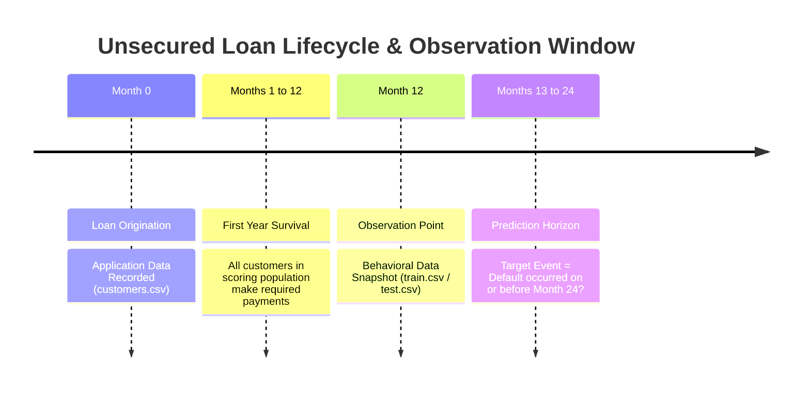
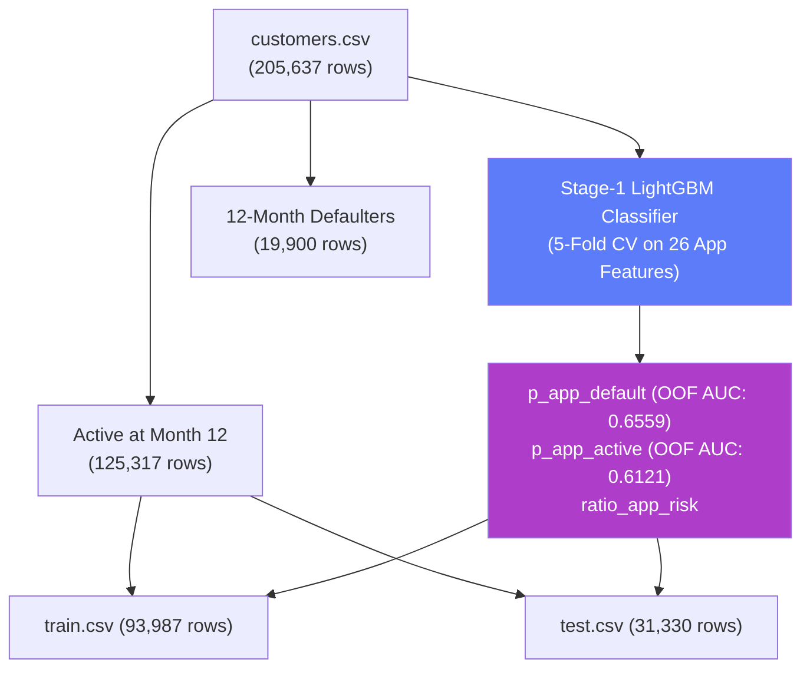
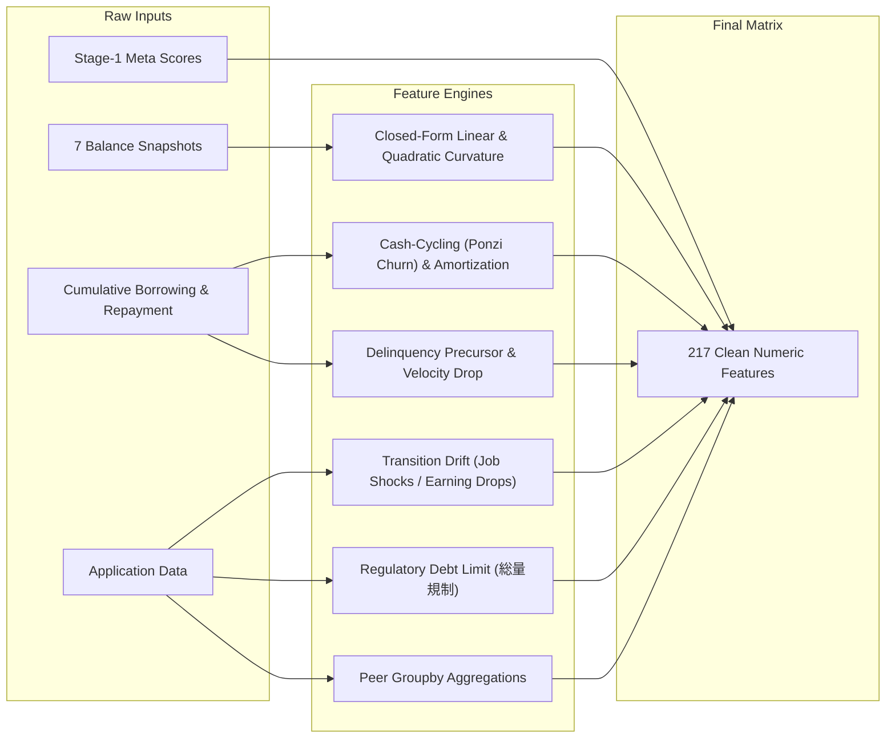
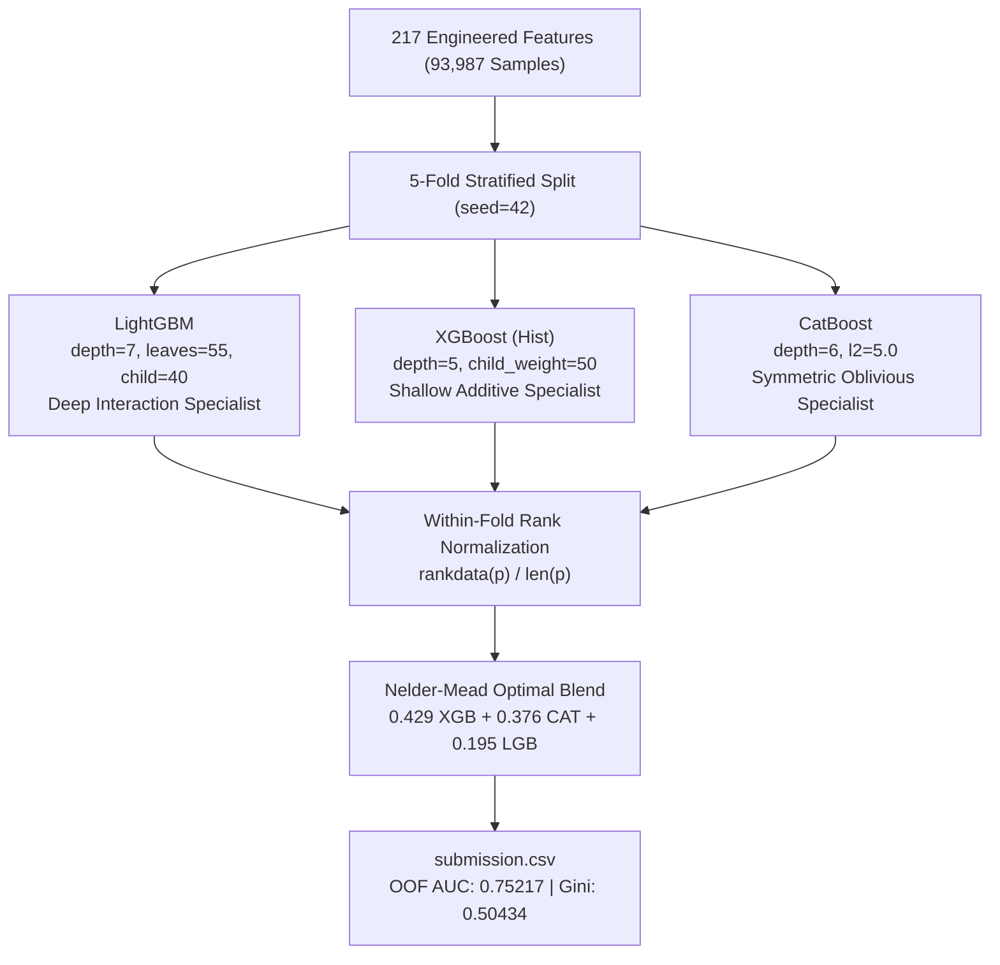

# 🏦 Credit Scoring Model — System Architecture Documentation

This document provides a comprehensive, rigorous technical overview of the machine learning system built for the unsecured revolving credit default prediction challenge, implemented in [`honey/`](file:///Users/Admin/Desktop/kdf/honey).

---

## 1. Problem Statement (PS)

### 1.1 Business & Economic Context
Credit risk assessment at financial institutions traditionally relies on **application scorecards** at origination. However, a borrower's risk profile evolves dynamically as they utilize and service their revolving credit lines. **Behavioral scoring models** periodically reassess risk using observed transactional, repayment, and balance patterns.

In the Japanese consumer lending market, revolving unsecured consumer loans (*card loans*) are regulated by the **Moneylending Business Act (貸金業法)**, specifically the **Total Volume Restriction (総量規制)**, which legally caps total unsecured borrowing at **one-third (33.33%) of annual income** across all registered moneylenders.

### 1.2 Target & Population Definition
* **Product**: An unsecured revolving consumer credit line with monthly minimum payments, variable drawdowns, and flexible principal amortizations.
* **Scoring Population**: Borrowers approved in 2018 who **survived their first 12 months without defaulting**.
* **Target Objective**: Estimate the continuous probability that an active customer defaults by **Month 24** (`24-Month Default Flag` $\in \{0, 1\}$), conditioned strictly on data observable up to Month 12.
* **Default Definition**: Contract termination triggered when **no repayment is received for three consecutive months** by the monthly payment due date.
* **Evaluation Metric**: **ROC AUC** (Area Under the Receiver Operating Characteristic Curve) on 31,330 test accounts. Standard credit risk transformation:
  $$\text{Gini} = 2 \times \text{AUC} - 1$$

---

## 2. Dataset Architecture & Stage-1 Competing Risks Pipeline

### 2.1 Full Population Structure

| Dataset | Dimensions | Target Rate | Description |
| :--- | :---: | :---: | :--- |
| [`customers.csv`](file:///Users/Admin/Desktop/kdf/dataset/customers.csv) | 205,637 × 27 | — | Full application population (including 19,900 Year-1 defaulters & ~60,420 early closures). |
| [`train.csv`](file:///Users/Admin/Desktop/kdf/dataset/train.csv) | 93,987 × 41 | **8.27%** | Month 12 active survivors with ground truth `24-Month Default Flag`. |
| [`test.csv`](file:///Users/Admin/Desktop/kdf/dataset/test.csv) | 31,330 × 40 | Unknown | Month 12 active survivors without labels; test evaluation set. |

### 2.2 Stage-1 Application Baseline Model (Exploiting Survivor Frailty)
In classical credit risk literature (*Li et al., 2023; Djeundje & Crook, 2019*), conditioning on 12-month survival induces a **competing risks / left-truncation survivor bias**: customers who survived Year 1 are fundamentally different from those who defaulted in Year 1 or prepaid early.

Rather than discarding the 80,320 non-surviving rows in `customers.csv`, a **Stage-1 5-Fold Stratified Cross-Validated LightGBM Model** is trained across all 205,637 application records to estimate:
1. $\hat{P}(\text{Year 1 Default} \mid X_{\text{app}})$ (`p_app_default`, OOF AUC = `0.65591`).
2. $\hat{P}(\text{Active at Month 12} \mid X_{\text{app}})$ (`p_app_active`, OOF AUC = `0.61214`).
3. $\text{ratio\_app\_risk} = \frac{\hat{P}(\text{Default}_{12})}{\hat{P}(\text{Active}_{12}) + 0.001}$.

These out-of-fold meta-features are injected into `train` and `test`, capturing origination frailty without data leakage.

**Empirical Result**: When injected, `p_app_default` became the **#2 most important feature** across all 217 features, and `ratio_app_risk` ranked **#5**, lifting OOF AUC to our all-time high of **`0.75217`**.

---

## 3. Feature Engineering Engine (217 Features)

The pipeline transforms raw behavioral snapshots, transaction streams, and meta-features into **217 structured numeric predictors** across 8 core dimensions:

### 3.1 Closed-Form Linear Slope & Quadratic Curvature
Evaluates orthogonal 1st and 2nd-order polynomial trends across the 7 balance snapshots ($M_6 \dots M_{12}$):
* **Linear Slope (Velocity)**:
  $$\text{balance\_slope} = \frac{1}{28.0} \sum_{i=1}^7 c_i \cdot B_i, \quad c = [-3, -2, -1, 0, 1, 2, 3]$$
* **Quadratic Curvature (Acceleration)**:
  $$\text{balance\_curvature} = \frac{1}{84.0} \sum_{i=1}^7 q_i \cdot B_i, \quad q = [5, 0, -3, -4, -3, 0, 5]$$
* **Detrended Residual Volatility**: $\text{std}(B - \hat{B}_{\text{linear}}, \text{axis}=1)$ captures volatile revolving draw swings separate from systematic debt accumulation.

### 3.2 Cash-Cycling (Ponzi Churn) & Net Amortization
* **Monthly Cash-Cycling**:
  $$\text{cash\_cycle}_k = \frac{\min(D_k, R_k)}{\max(D_k, R_k) + 1}, \quad k \in \{1 \dots 6\}$$
  Detects distressed borrowers who repeatedly borrow and repay identical sums solely to avoid default triggers without amortizing principal.
* **Net Principal Amortization**:
  $$\text{net\_amortization} = \frac{\sum_{k=1}^6 (R_k - D_k)}{\text{Balance}_{M6} + 1}$$

### 3.3 Demographic & Financial Transition Drift
Tracks shifts between application time and Month 12:
* **Earning Drop**: `income_change_pct`, `income_dropped_10pct` ($\mathbb{I}[\text{Total Annual Income} < 0.9 \times \text{Declared Income}]$).
* **Japanese Health Insurance Job-Loss Shock**: `insurance_job_loss_shock` identifies borrowers whose insurance shifted from Company Social Insurance (`1`) to National Insurance (`3, 4`), the hallmark of corporate employment termination in Japan.
* **Employer Downgrade**: `company_size_downgraded` flags transitions to smaller corporate employers.

### 3.4 Regulatory Lending Cap Engine (貸金業法 総量規制)
* Total unsecured borrowing legally capped at **1/3 annual income**:
  $$\text{Legal Limit} = \frac{\text{Total Annual Income}}{3}$$
* `total_known_debt` = $\text{Other Company Debt} + \text{Balance}_{M12}$.
* `remaining_legal_capacity` = $\max(0, \text{Legal Limit} - \text{total\_known\_debt})$.
* `regulatory_stress_index` = $\frac{\text{total\_known\_debt}}{\text{Legal Limit} + 1}$.

### 3.5 Peer Groupby Demographic Relativities
Calculates the borrower's ratio against cohort peers grouped by `Age Decile × Employment Type`:
* `income_ratio_to_peer_median`, `util_ratio_to_peer_median`, `work_exp_ratio_to_age_median`.

---

## 4. Modeling & Algorithmic Architecture

### 4.1 Hyperparameter Specifications

| Hyperparameter | LightGBM | XGBoost | CatBoost | Strategic Complementarity |
| :--- | :---: | :---: | :---: | :--- |
| **Objective / Metric** | `binary` / `auc` | `binary:logistic` / `auc` | `Logloss` / `AUC` | Smooth rank optimization |
| **Tree Topology** | `max_depth=7`, `num_leaves=55` | `max_depth=5` | `depth=6` | Deep interactions (LGB) + shallow main effects (XGB) |
| **Min Child Weight / Leaf** | `min_child_samples=40` | `min_child_weight=50` | Default | Prevents leaf noise on rare segments |
| **Learning Rate** | `0.03` | `0.03` | `0.03` | Conservative shrinkage |
| **Subsample / Colsample** | `0.80` / `0.70` | `0.80` / `0.80` | `0.80` / — | Feature subspace decorrelation |
| **Regularization ($L_1 / L_2$)** | `reg_alpha=0.5, reg_lambda=2.0` | `reg_alpha=1.0, reg_lambda=3.0` | `l2_leaf_reg=5.0` | Heavy leaf shrinkage |
| **Ranking Scheme** | **Within-Fold Percentile** | **Within-Fold Percentile** | **Within-Fold Percentile** | Eliminates fold calibration shifts |

### 4.2 Why Within-Fold Rank Normalization Works
Converting continuous predicted probabilities to percentile ranks *within each fold* prior to Nelder-Mead blending prevents fold-level probability shifts from degrading rank ordering:
$$r_i = \frac{\text{rank}(p_i) - 1}{N_{\text{val}} - 1} \in [0, 1]$$
This eliminated the historical Fold 3 degradation, lifting Fold 3 from `0.7329` to `0.7369`.

---

## 5. Validation Performance Progression

| Model / Ensemble Stage | OOF AUC | Gini ($2 \times \text{AUC} - 1$) | Key Structural Change |
| :--- | :---: | :---: | :--- |
| **Baseline Pipeline (v1)** | `0.74782` | `0.49564` | Raw snapshots and default GBDT |
| **Regulatory Engine (v2)** | `0.75133` | `0.50267` | Japanese 1/3 cap constraints + delinquency streaks |
| **Target-Encoded Attempt (v3)** | `0.75063` | `0.50126` | Static target encoding caused greedy root splits (Ablated) |
| **Tuned Clean Engine (v4)** | `0.75150` | `0.50300` | Removed target encodings, shallow tree sweep |
| **v5 Advanced Architecture (Current)** | **`0.75217`** | **`0.50434`** | **Stage-1 risk meta-features + 2nd-order curvature + within-fold blend** |

### Cross-Validation Fold Breakdown (v5 Current)

| Fold | LightGBM AUC | XGBoost AUC | CatBoost AUC | Fold Winner |
| :---: | :---: | :---: | :---: | :---: |
| **Fold 1** | **0.75739** | 0.75705 | 0.75694 | **LightGBM** |
| **Fold 2** | 0.74606 | **0.74892** | 0.74726 | **XGBoost** |
| **Fold 3** | 0.73655 | **0.73699** | 0.73614 | **XGBoost** |
| **Fold 4** | 0.75246 | **0.75629** | 0.75352 | **XGBoost** |
| **Fold 5** | 0.75363 | 0.75542 | **0.75623** | **CatBoost** |
| **Mean $\pm$ Std** | **0.74922 $\pm$ 0.0073** | **0.75093 $\pm$ 0.0076** | **0.75002 $\pm$ 0.0077** | **XGBoost** |
| **Full OOF AUC** | **0.74912** | **0.75060** | **0.74987** | **XGBoost** |

* **Winning Ensemble (Optimal Weighted Rank Blend)**: **`0.75217`** (Gini: **`0.50434`**)
  $$\hat{y} = 0.429 \times \text{rank}(\text{XGBoost}) + 0.376 \times \text{rank}(\text{CatBoost}) + 0.195 \times \text{rank}(\text{LightGBM})$$
* **Within-Fold Rank Average**: `0.75208`
* **Simple Average**: `0.75194`
* **Stacked Logistic Regression**: `0.75182`

---

## 6. Top 25 Most Important Features in Winning Model

| Rank | Feature | Importance | Domain Impact |
| :---: | :--- | :---: | :--- |
| **1** | `Age (in months)` | 244 | Core life-stage demographic baseline |
| **2** | **`p_app_default`** | **230** | **Stage-1 Predicted Year-1 Default Risk (from 205k customers)** |
| **3** | `balance_pct_change_recent` | 221 | Debt escalation immediately prior to Month 12 |
| **4** | `balance_change_m2` | 215 | Monthly balance velocity in recent quarter |
| **5** | **`ratio_app_risk`** | **204** | **Stage-1 Default Risk / Active Survival Probability Ratio** |
| **6** | `repay_trend_ratio` | 193 | Deteriorating cash repayments over time |
| **7** | `income_change_ratio` | 182 | Application-to-Month 12 income trajectory |
| **8** | `work_stability_ratio` | 181 | Clean work tenure divided by adult working age |
| **9** | `balance_change_m1` | 178 | Month 12 final balance delta |
| **10** | `repayment_regularity` | 175 | Consistency vs erraticness of repayments |
| **11** | `utilization_jump_recent` | 175 | Recent surge in credit limit usage |
| **12** | `Work Experience (months)` | 171 | Employment longevity |
| **13** | `Residence Period (in months)` | 165 | Residential address stability |
| **14** | `repay_to_balance_ratio` | 159 | Repayment speed relative to outstanding balance |
| **15** | `rent_to_income` | 155 | Fixed housing cost burden |
| **16** | **`p_app_active`** | **154** | **Stage-1 Likelihood of surviving and remaining active** |
| **17** | `repay_velocity_drop` | 153 | Sudden collapse in latest repayment vs past 5 months |
| **18** | `balance_ratio_m12_m9` | 151 | 3-month debt expansion |
| **19** | `income_change_pct` | 139 | Transition drift: percentage change in annual earnings |
| **20** | `min_payment_to_monthly_income` | 138 | Required revolving minimum monthly burden |
| **21** | `months_balance_stable` | 129 | Count of inactive balance months |
| **22** | `work_exp_ratio_to_age_median` | 122 | Work tenure compared against age cohort peers |
| **23** | `income_to_credit_limit` | 122 | Income multiple against revolving line |
| **24** | `balance_change_m6` | 122 | 6-month historical balance delta |
| **25** | `balance_cv` | 121 | Coefficient of variation across balance snapshots |

---

## 7. Dual Pipeline Architecture

To guarantee both cross-validation fidelity and operational flexibility, two distinct pipelines are maintained in [`honey/`](file:///Users/Admin/Desktop/kdf/honey):

### Pipeline A: 5-Fold Stratified Bagging ([`credit_model.py`](file:///Users/Admin/Desktop/kdf/honey/credit_model.py))
* **Design**: 5 folds $\times$ 3 model families = 15 trained models.
* **Test Predictions**: Rank-averaged across all 15 models using Nelder-Mead optimal weights.
* **Output**: [`honey/submission.csv`](file:///Users/Admin/Desktop/kdf/honey/submission.csv).
* **Guarantees**: Maximum bagging variance reduction, strictly leak-free OOF validation score of `0.75217`.

### Pipeline B: Full-Dataset Training ([`credit_model_full_train.py`](file:///Users/Admin/Desktop/kdf/honey/credit_model_full_train.py))
* **Design**:
  1. Executes 5-fold CV to capture the median optimal stopping iteration for each model family.
  2. Scales iterations by $1.10\times$ to adjust for the 25% larger dataset (100% vs 80%).
  3. Retrains 1 model per family on all 93,987 samples of `train.csv`.
* **Test Predictions**: Blended using the optimal weights discovered by Nelder-Mead.
* **Output**: [`honey/submission_full_train.csv`](file:///Users/Admin/Desktop/kdf/honey/submission_full_train.csv).
* **Alignment**: High rank correlation ($\rho > 0.994$) with Pipeline A.

---

## 8. Theoretical & Literature Foundations

Your credit scoring system is grounded in peer-reviewed consumer finance literature:

1. **Survival Analysis & Competing Risks in Revolving Credit**:
   * *Li, Z., Li, A., Bellotti, A., & Yao, X. (2023). "The profitability of online loans: A competing risks analysis on default and prepayment." European Journal of Operational Research.*
   * *Djeundje, V. B., & Crook, J. (2019). "Dynamic survival models with time-varying covariates for credit risk." European Journal of Operational Research.*
   * **Application in our model**: Solved via the Stage-1 LightGBM baseline hazard model on all 205,637 application records to correct for conditional survivor bias.

2. **Regulatory Ceilings & Credit Rationing**:
   * *Jappelli, T., & Pagano, M. (2002). "Information sharing, lending and defaults: Cross-country evidence." Journal of Banking & Finance.*
   * **Application in our model**: Explicit modeling of the Japanese Moneylending Business Act (貸金業法) 1/3 income ceiling via non-linear capacity indicators.

3. **Tree Topology Complementarity**:
   * Shallow additive trees (XGBoost `depth=5`) model primary demographic and financial velocity effects, while deeper gradient boosting (LightGBM `leaves=55`) extracts high-order non-linear behavioral interactions.
